# Frontend review — 13 November 2026

The main library and organization flows are more consistent after this pass. The largest bugs were lost local organization after reload, details panels showing items outside the visible shelf, inconsistent finished/unread state, and recent sorting that put new imports in the wrong place. These are fixed. Quick notes, note editing, and filtered Markdown export are now available from Annotations.

The frontend still includes an explicitly labelled reader preview and sample reading sessions. Importing EPUB/CBZ files works; rendering those files and recording real reading sessions remain separate work.

## Scope and evidence

- Reviewed state, persistence, importing, library ordering, shelves, collections, annotations, profile, activity, settings, and cross-page navigation.
- Captured the running Windows app at 802 × 631 and 1739 × 978. All screenshots below were captured in this review, saved, reopened, and accepted after inspection.
- The in-app browser preview timed out, so visual verification used the native Tauri window. This is not a browser compatibility certification.
- Kept the existing design direction, compact controls, normal sidebar text, and shadcn/ui components.

## Reviewed flows

### 1. Browse, filter, and organize the library — healthy after fixes

The library and shelf lists retain their existing appearance. The details panel now chooses a book from the visible result set. An empty filtered shelf no longer displays an unrelated book on the right. Its footer shows the filtered count and the empty state offers a clear recovery action. Collections use the same sorting rules and support Enter to open the selected collection.

Before, compact shelf layout:

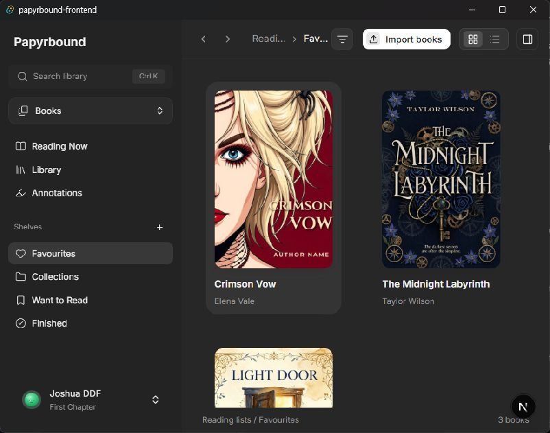

After, desktop library:

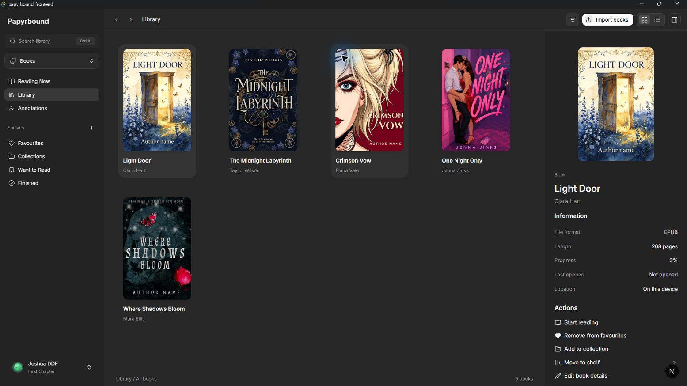

After, filtered shelf with no results:

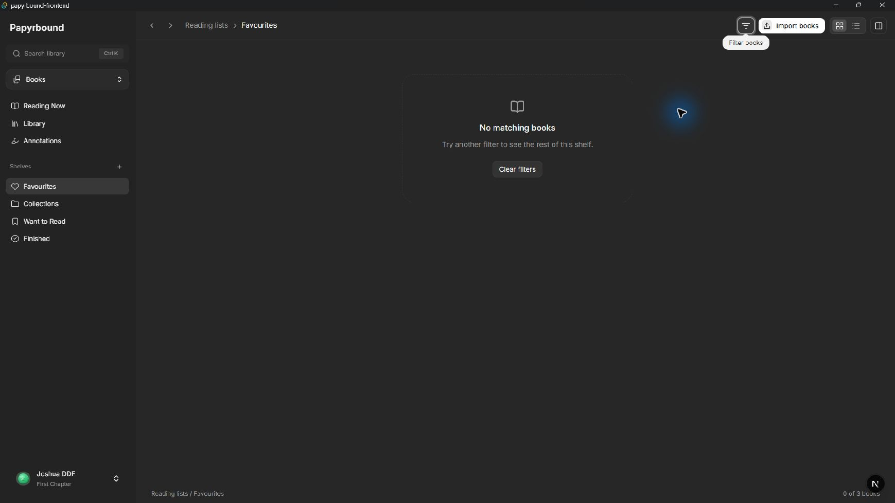

After, empty Comics library:

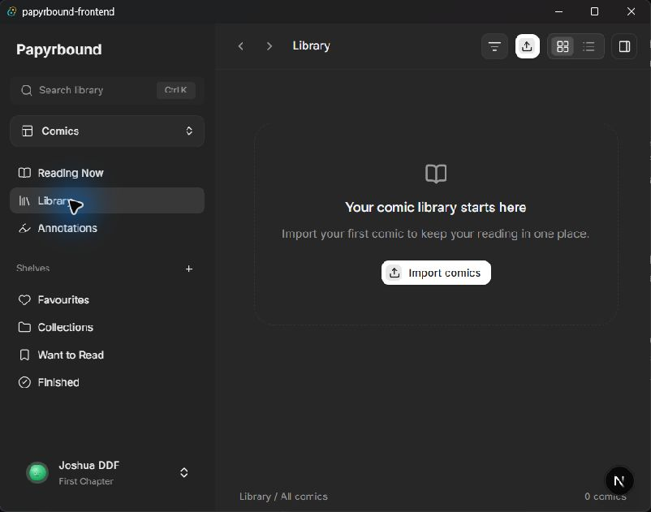

Checked switching to Comics, reloading, and seeing the same mode restored; restored Books afterward. Checked clearing the empty shelf filter. The active filter has a visible state and an accessible label. Compact toolbar actions keep room for breadcrumbs. Keyboard focus indicators remain visible; a full screen-reader pass was not performed.

### 2. Choose what to read next — logic fixed; reader remains a preview

Next Up now prefers an unread item from Want to Read and excludes finished items. Recently added uses import timestamps, with stable fallback ordering for older entries. Finished actions remove an item from Want to Read; unread actions reset progress and Finished membership together.

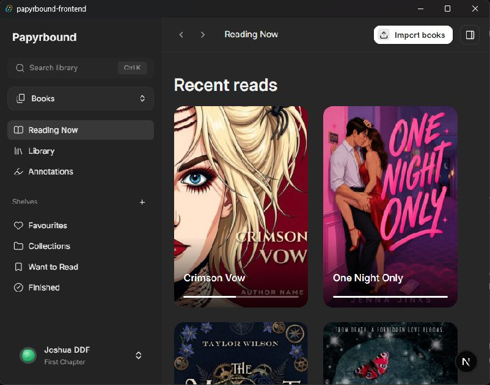

The review also removed the blank reserved details-column space when that panel is hidden. Sorting, queue selection, duplicate imports, and reading-state transitions are covered by tests. Real in-book navigation and progress recording are outside the current preview.

### 3. Find, create, edit, and export annotations — healthy after fixes

The existing annotation editor was unreachable. It is now available from each note/highlight menu. A top-bar New note action supports quick notes; highlight passages stay read-only while their thoughts can be edited. The view menu contains expand/collapse and Markdown export. Export respects the active library and current filters. Stale fixed Today/Yesterday text now follows actual annotation timestamps.

Before:

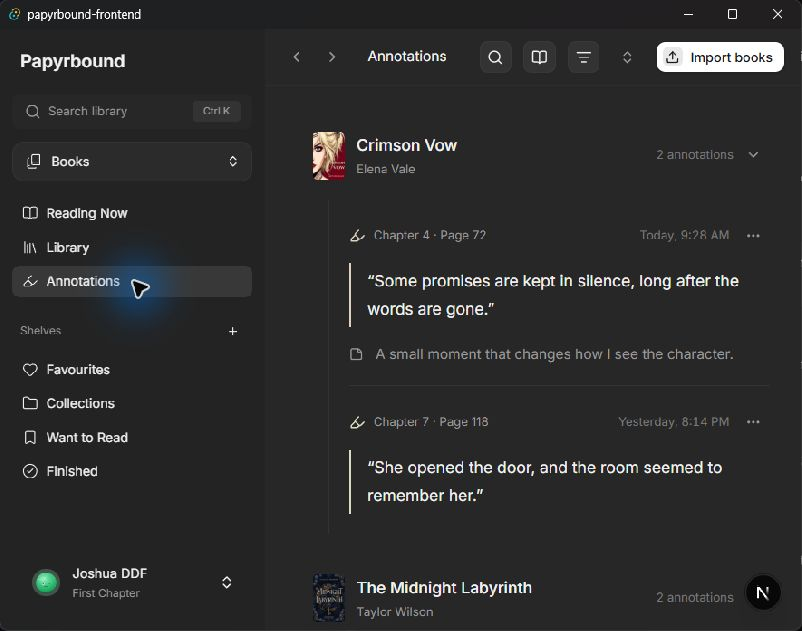

After:

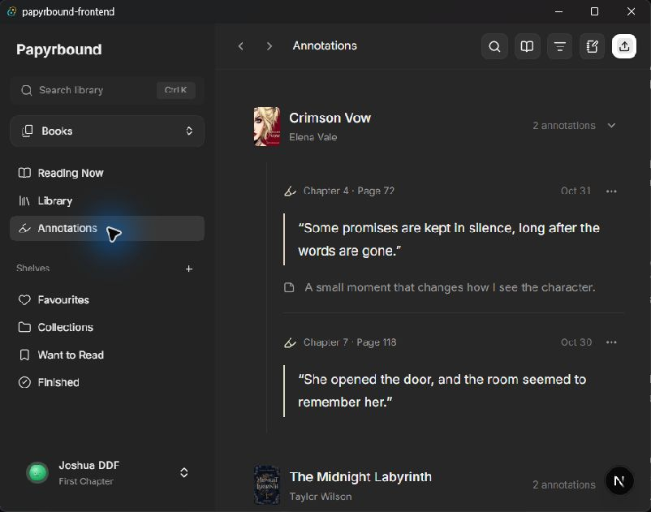

New-note dialog:

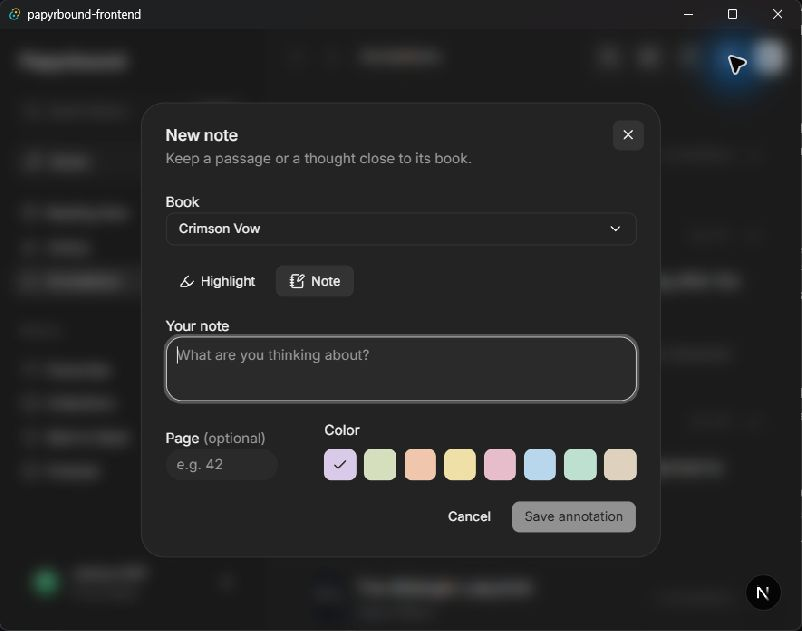

Opened the new-note form and cancelled without adding test data to the user's notes. Filtering, date rollover, and multiline Markdown output are covered by tests. The editor uses labelled controls and retains the shadcn dialog and disabled empty-submit state. The actual OS download destination was not exercised.

### 4. Open the profile and reading activity — layout healthy; activity data is a preview

Profile reading links now reveal their book even when the library previously had an incompatible filter. The empty bio action has its own line. Embedded reading activity uses a responsive 26-week chart instead of the full-width annual chart, and starts on the latest available date. Account creation and today's date still bound available days.

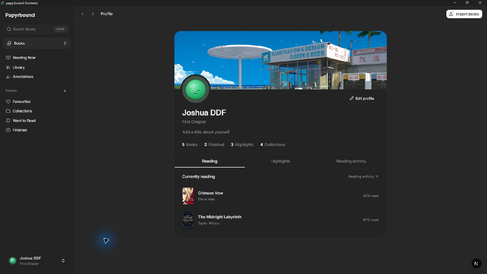

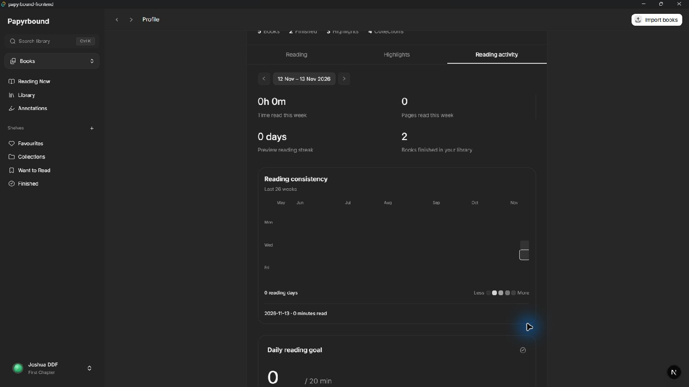

This local account was created recently, so earlier heatmap dates are unavailable and its visible totals are zero. The chart does not fabricate sessions before account creation. The daily goal is now saved with account preferences. The chart's day buttons retain labels and pressed states; comprehensive assistive-technology testing remains outstanding.

### 5. Adjust settings and navigate after scrolling — healthy after fixes

Settings now use the shared shadcn Select for value choices. Narrow layouts wrap footer content and controls. The desktop preview stays below the sticky header. Added a document scroll offset after observing Settings' title partially behind the header when navigating from a scrolled profile; repeated that transition and confirmed the title is fully visible.

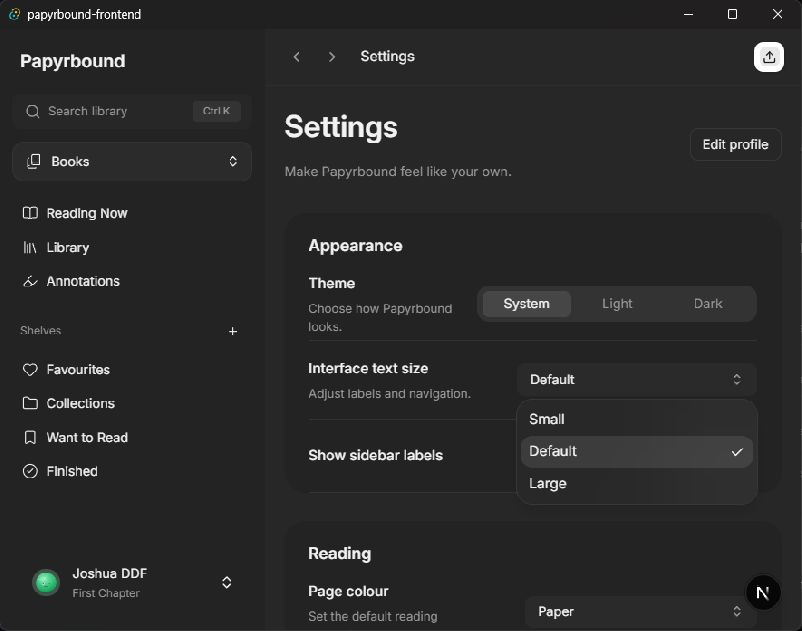

Transient book dialogs close when the route changes. Search-result navigation clears incompatible filters and stale dialogs. Settings selection, switch controls, and a visible focus outline were inspected. Reading appearance controls still apply to the labelled preview until the reader is connected.

## Local data fixes

Library metadata, custom shelves, collections, annotations, reading settings, view mode, selected Books/Comics mode, and details-panel preference now persist locally. Imported files and cover data stay in IndexedDB rather than being duplicated in localStorage. Empty saved lists remain empty after reload.

Saved data is validated before hydration. Unreadable data and failed writes surface a storage warning. A malformed stored value is not overwritten just by reading it. Transient dialogs, queries, filters, and editing flags are excluded from durable state. This does not recover organization lost before persistence was added and does not provide cloud synchronization.

## Features worth adding next

These priorities are recommendations from the reviewed flows, not implemented features in this pass:

1. **Backup/restore and undo.** Export the local account, library organization, annotations, and reading metadata; optionally include original files. Validate a restore before applying it. Offer undo for removing a book/note and changing shelves. This has the strongest benefit for an app whose data currently lives on one device.
2. **Connect the reader, saved positions, and real session tracking.** Use one location model for resume, bookmarks, annotations, and navigation; record sessions for the active book/comic and replace the sample activity. Readium's [locator model](https://readium.org/architecture/models/locators/) is a useful reference for the location design. Toolkit/platform suitability still needs a separate evaluation before choosing a dependency.
3. **Bulk organization.** Allow selecting several books/comics and applying shelf, collection, finished, or remove actions together, with a visible selection count and undo. Reuse the existing action terminology and shared shadcn controls.

Implemented additions from this pass are quick notes, reachable note editing, and filtered Markdown export.

## Validation

- `npm test`: 23 passed, 0 failed. Includes EPUB/CBZ parsing and IndexedDB byte preservation, duplicate/concurrent import handling, local persistence, ordering, shelf transitions, annotation filtering/export, account dates, DST, and streak bounds.
- `npm run lint`: passed.
- `npx tsc --noEmit`: passed.
- `npx next build --webpack`: passed; all 9 application routes generated successfully, plus the not-found route.
- `git diff --check`: passed.
- Native checks: compact and wide layouts, filtered shelf recovery, empty Comics library, mode persistence across reload, new-note dialog, profile activity, settings Select, and navigation after scrolling.

The tests use fixtures for imported archives and fake IndexedDB. They do not prove behavior for every real-world EPUB/CBZ or physical storage exhaustion. No destructive UI operation was performed against the user's library. Screenshots and code checks do not establish full WCAG compliance. Light-theme, screen-reader, and broader platform coverage remain useful release checks.

## Implementation commits

- `25d8b35` — Persist local library organization and reading preferences.
- `dcb05e0` — Fix library selection, recent sorting, and reading state consistency.
- `895fdfc` — Restore note editing and add filtered Markdown export.
- `6a82183` — Polish empty states, compact layouts, and cross-page navigation.
- `330a90e` — Keep navigation targets below the sticky header.

No new UI dependency was needed. Existing shared shadcn controls cover the implemented changes.
